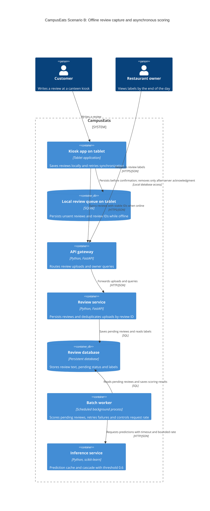

# Task 4: Deployment topologies and trade-offs

**Name / ชื่อ:** กชพรรณ เลิศปัญญาโรจน์

**Student ID / รหัสนิสิต:** 6630001321

This is **individual work**: each student completes and submits their own copy, in their own fork.

*งานนี้เป็น**งานเดี่ยว** นิสิตแต่ละคนทำและส่งงานของตัวเอง ใน fork ของตัวเอง*

**Scenario (A, B or C) / Scenario ที่เลือก:** B. Canteen kiosk

Choose **one** scenario below. If the last digit of your student ID is odd, take A or B; if it is even, take B or C. Use your measurements from Tutorial 6 as evidence: cite run names from `results/runs.csv`. Answer in Thai or English.

เลือก scenario **หนึ่ง** ข้อด้านล่าง ถ้าเลขตัวสุดท้ายของรหัสนิสิตเป็นเลขคี่ ให้เลือก A หรือ B ถ้าเป็นเลขคู่ ให้เลือก B หรือ C ใช้ผลการวัดจาก tutorial ที่ทำไปเป็นข้อมูลอ้างอิง โดยอ้างชื่อ run จาก `results/runs.csv` จะตอบเป็นภาษาไทยหรือภาษาอังกฤษก็ได้

Facts that hold in every scenario / ข้อเท็จจริงที่ใช้กับทุก scenario:

- The large model serves at most **20 calls per second** (4 calls at once × about 200 ms each), and every call costs money.

  *large model รับได้สูงสุด **20 calls ต่อวินาที** (พร้อมกัน 4 calls × ประมาณ 200 ms ต่อ call) และทุก call มีค่าใช้จ่าย*
- The small model is fast and cheap enough to run anywhere, including inside the review service or on a kiosk, but it is much less accurate on its own.

  *small model เร็วและถูกพอที่จะรันที่ไหนก็ได้ รวมถึงภายใน review service หรือบน kiosk แต่ถ้าใช้ตัวเดียวจะแม่นน้อยกว่ามาก*

## Scenarios

**A. Owner alerts.** When a customer posts a negative review, the restaurant owner gets a push notification within **2 seconds**. At the lunch peak, CampusEats receives **40 reviews per second**. A missed alert is acceptable, but a wrong alert (for example, "your customer is unhappy" when they are happy) makes owners stop trusting alerts and, in the end, ignore them.

*เมื่อลูกค้าโพสต์รีวิวเชิงลบ เจ้าของร้านจะต้องได้รับ push notification ภายใน **2 วินาที** เวลาช่วงพีคตอนเที่ยง CampusEats ได้รับรีวิวจำนวน **40 รายการต่อวินาที** การพลาด alert ไปบ้างนั้นยอมรับได้ แต่ alert ที่ผิด (เช่น "ลูกค้าไม่พอใจ" ทั้งที่จริงๆ แล้วพอใจ) จะทำให้เจ้าของร้านไม่เชื่อถือและเลิกสนใจ alert ในที่สุด*

**B. Canteen kiosk.** A tablet in each canteen lets students leave a review on the spot. However, the canteen Wi-Fi is poor: the tablets lose their connection several times a day, for minutes at a time. The system must accept every review, even while a tablet is offline. Restaurant owners need the labels **by the end of the day**.

*มี tablet ในแต่ละโรงอาหารให้นิสิตรีวิวได้ทันที อย่างไรก็ดี การเชื่อมต่อ Wi-Fi ในโรงอาหารไม่ดี ทำให้ tablet หลุดการเชื่อมต่อวันละหลายครั้ง ครั้งละหลายนาที ระบบจะต้องรับรีวิวได้ทุกรายการแม้ขณะที่กำลัง offline อยู่ และเจ้าของร้านต้องการ label **ภายในสิ้นวัน***

**C. Weekly report.** Restaurant owners want a weekly sentiment report. Nothing in producing this report has to be real-time. **Accuracy matters most** and **cost must be minimal**.

*เจ้าของร้านต้องการรายงาน sentiment รายสัปดาห์ ไม่มีอะไรที่จะต้องทำแบบ real-time ในการออกรายงานนี้ ความแม่นยำ **(accuracy) สำคัญที่สุด** และ **ค่าใช้จ่ายต้องน้อยที่สุด***

## Topologies and patterns to choose from / Topology และ pattern ที่เลือกใช้ได้

| | Topology | Where the model runs / โมเดลรันที่ไหน |
|---|---|---|
| T1 | Model as a service, synchronous | Inference service, called for each review (today's baseline) *inference service ถูกเรียกทุกรีวิว (baseline ของวันนี้)* |
| T2 | Model as a library | Inside the review service, or on the device *ภายใน review service หรือบนอุปกรณ์* |
| T3 | Hybrid | Small model locally, large model as a remote service *small model รันในเครื่อง large model เป็น remote service* |
| T4 | Asynchronous / batch | Reviews are queued (broker, W10) or stored, and scored later in bulk *รีวิวถูกเข้าคิว (broker, W10) หรือเก็บไว้ แล้วติด label ทีหลังเป็นชุด* |

Combine one topology with any of the patterns from Tutorial 6: **fallback**, **cascade** and **cache**.

*เลือก topology หนึ่งแบบ แล้วผสมกับ pattern จาก Tutorial 6 ได้ตามต้องการ: **fallback**, **cascade** และ **cache***

## 1. Quality requirements

The three most important quality requirements for your scenario, each with a number where possible.

*quality requirements ที่สำคัญที่สุด 3 ข้อของ scenario ที่เลือก ระบุตัวเลขเมื่อทำได้*

| # | Quality | Requirement |
|---|---|---|
| 1 | Availability / Reliability | รับและบันทึกรีวิวทุกครั้งแม้ tablet offline โดยเก็บลง persistent local queue ก่อนยืนยันให้ผู้ใช้ และไม่ลบจนกว่า server ยืนยันว่าบันทึกแล้ว การส่งซ้ำต้องไม่สร้างรีวิวซ้ำ |
| 2 | Timeliness | รีวิวของวันนั้นต้องได้ label ภายในสิ้นวัน โดย sync เมื่อกลับมาออนไลน์และประมวลผล pending เป็นระยะตลอดวัน พร้อมติดตามอายุและจำนวนงานค้าง |
| 3 | Accuracy | label ถูกต้องอย่างน้อย 90% ของรีวิวที่ได้ label ตามข้อกำหนดเดิมของ CampusEats และต้องติดตาม pending แยกต่างหากเพื่อไม่ให้ accuracy บดบังรีวิวที่ยังไม่ได้ประมวลผล |

นอกจากนี้ ต้องลดจำนวนการเรียก large model โดยไม่ทำให้ accuracy ต่ำกว่าเกณฑ์ และจำกัดการเรียก large model ไม่เกิน 20 calls ต่อวินาที โดยมี calls ที่กำลังประมวลผลพร้อมกันไม่เกิน 4 รายการ

## 2. Design / การออกแบบ

Your topology, the patterns you add, and a container-level diagram (C4 level 2). The C4 diagram must be written in Mermaid.

*topology ที่เลือก pattern ที่เพิ่ม และ diagram ระดับ container (C4 level 2) เขียนด้วย Mermaid*

เลือก **T4: Asynchronous / batch** เพราะการรับรีวิวต้องทำได้ขณะ offline ส่วนการติด label รอได้ถึงสิ้นวัน ทั้ง small และ large model ทำงานใน inference service ฝั่ง server โดยใช้ **cascade ที่ threshold 0.6**, **prediction cache** และ **fallback เป็น pending**

1. Kiosk app สร้าง review ID แล้วบันทึกรีวิวลง persistent local queue บน tablet ก่อนแจ้งว่าส่งรีวิวสำเร็จ จึงไม่ต้องรอเครือข่ายหรือโมเดล และยังเก็บรีวิวไว้ได้เมื่อปิดแล้วเปิดแอปใหม่
2. เมื่อเชื่อมต่อได้ แอปส่งรีวิวที่ยังไม่ได้รับการยืนยันผ่าน gateway ไปยัง review service ซึ่งบันทึกลงฐานข้อมูลเป็น pending และตอบรับหลังบันทึกสำเร็จ จากนั้น tablet จึงลบรายการออกจาก local queue โดย server ใช้ review ID ป้องกันข้อมูลซ้ำเมื่อมีการส่งซ้ำ
3. Batch worker อ่าน pending reviews เป็นชุดเล็ก ๆ เป็นระยะตลอดวัน แล้วขอผลจาก inference service โดยตรวจ cache ก่อน หากไม่พบจึงถาม small model และเรียก large model เฉพาะเมื่อ confidence ต่ำกว่า 0.6
4. เมื่อได้ผลให้บันทึก label และเปลี่ยนสถานะเป็น scored หาก inference timeout หรือ error ให้คงสถานะ pending แล้ว retry แบบเว้นระยะ พร้อมจำกัด rate และ concurrency ของ large model ตาม capacity
5. เจ้าของร้านดูผลที่ประมวลผลแล้วจาก review service ระบบติดตามรีวิวที่ยังไม่ sync และ pending ที่ใกล้หมดเวลา เพื่อเร่งแก้ปัญหาก่อนสิ้นวัน

การรับประกัน deadline ต้องมีเงื่อนไขว่า tablet กลับมาออนไลน์ก่อนสิ้นวันโดยเหลือเวลาสำหรับ sync และประมวลผลเพียงพอ หาก tablet offline ข้าม deadline ระบบส่วนกลางจะยังไม่มีรีวิวนั้น จึงไม่สามารถรับประกัน label ภายในวันเดียวกันได้ ต้องวัดปริมาณรีวิวและเวลาระบายงานค้างเพิ่มเติมเพื่อกำหนดเวลา sync ล่าสุดและรอบ batch ที่เหมาะสม

## 3. Evidence / หลักฐาน

Which runs support your choice? Show the numbers and, for scenario A, the capacity arithmetic: how many large-model calls per second does your design need at the peak?

*run ไหนที่สนับสนุนการตัดสินใจของนิสิต ให้นิสิตแสดงตัวเลขประกอบ และสำหรับ scenario A ให้นิสิตแสดงการคำนวณ capacity ด้วย เพื่อแสดงว่าในช่วงพีคนั้น design ของนิสิตต้องใช้ large model กี่ calls ต่อวินาที*

| Run | What it shows / แสดงอะไร |
|---|---|
| t0-small | accuracy 72.5%, p50 54 ms และ large calls 0% แสดงว่า small model เร็วและประหยัด แต่ใช้เพียงตัวเดียวไม่ผ่านเกณฑ์ accuracy 90% |
| t0-large | accuracy 93.5%, p50 507 ms, p95 615 ms และ large calls 100% ใช้เป็น baseline ด้านความแม่นยำและจำนวนการเรียกโมเดลราคาแพง |
| t2-0.6 | accuracy 91.5%, p50 57 ms, p95 481 ms และ large calls 38% เป็น threshold ที่เรียก large model น้อยที่สุดในค่าที่ทดลองและยังผ่าน accuracy 90% |
| t3-cache | ที่ threshold 0.6 ได้ accuracy 91.5%, large calls 31%, cache hits 36%, p50 14 ms และ p95 503 ms จึงลด large calls จาก baseline ประมาณ 69% และลดจาก cascade ที่ไม่เปิด cache อีก 7 จุดเปอร์เซ็นต์ โดย accuracy เท่าเดิม |
| t1-before / t1-after | เมื่อ hang rate เท่ากับ 0.1 การเพิ่ม fallback ทำให้ errors ลดจาก 27 เหลือ 0 และเวลารวมลดจาก 34.5 เป็น 9.9 วินาที แต่มี pending 24 รายการ สนับสนุนการเก็บรีวิวไว้และนำมาติด label ภายหลัง |

ผลเหล่านี้สนับสนุนการเลือก pattern แต่ยังเป็นการทดสอบระบบเดิมด้วย 200 requests ต่อ run ไม่ได้ทดสอบ offline queue หรือ batch topology ที่เสนอ จึงต้องทดสอบการตัดเครือข่าย การส่งซ้ำ การเปิดแอปใหม่ และการระบายงานค้างตามปริมาณจริงก่อนยืนยันว่าแบบออกแบบนี้ทำงานได้ครบและติด label ทันสิ้นวัน อีกทั้ง cache ช่วยลด p50 และจำนวน large calls ในรอบนี้ แต่ p95 ไม่ได้ลดลง จึงไม่ใช้ cache เป็นหลักฐานรับประกัน deadline เพียงอย่างเดียว

## 4. ADR

Use the ADR format from W5.

*ใช้รูปแบบ ADR จาก W5*

**Title:** รับรีวิวแบบ offline บน kiosk และติด label ด้วย asynchronous batch ร่วมกับ cascade และ cache

**Status:** Proposed

**Context:**

Tablet ในโรงอาหารขาดการเชื่อมต่อวันละหลายครั้ง ครั้งละหลายนาที แต่ระบบต้องรับรีวิวได้ทุกครั้ง ขณะที่เจ้าของร้านต้องการ label ภายในสิ้นวัน จึงไม่จำเป็นต้องรอโมเดลตอบตอนส่งรีวิว ผล t0-small มี accuracy เพียง 72.5% ส่วน t0-large แม่นยำ 93.5% แต่เรียก large model ทุกรีวิว ซึ่งมีต้นทุนและ capacity สูงสุด 20 calls ต่อวินาที

**Decision:**

เลือก T4: Asynchronous / batch โดยบันทึกรีวิวลง persistent local queue บน tablet ก่อน แล้ว sync ไปเก็บเป็น pending ในฐานข้อมูลของ server เมื่อออนไลน์ ใช้ review ID เดิมสำหรับ retry เพื่อป้องกันการสร้างข้อมูลซ้ำ และให้ batch worker ประมวลผลเป็นระยะด้วย cascade threshold 0.6 ร่วมกับ prediction cache หากโมเดล timeout หรือ error ให้คง pending และ retry ภายหลัง จำกัด large model ไม่เกิน 20 calls ต่อวินาทีและพร้อมกันไม่เกิน 4 calls พร้อมติดตามงานค้างก่อน deadline และแยก cache ตามเวอร์ชันโมเดลและการตั้งค่า cascade

**Consequences:**

- Positive: รับรีวิวได้ระหว่าง Wi-Fi หลุดโดยไม่ต้องรอ inference เก็บรีวิวไว้ได้เมื่อแอปเปิดใหม่ และ retry การส่งได้โดยไม่สร้างข้อมูลซ้ำ การติด label แยกจากการรับรีวิวช่วยรับมือกับ inference ที่ค้าง ส่วนผล t3-cache แสดง accuracy 91.5% และ large calls 31% จึงประหยัดกว่าการเรียก large model ทุกครั้งในชุดทดสอบนี้
- Negative: ผู้ใช้และเจ้าของร้านต้องยอมรับว่า label ไม่ได้มาทันที และ accuracy ลดจาก baseline 93.5% เหลือ 91.5% ต้องเพิ่ม local queue, persistent database, batch worker, retry, deduplication และ monitoring อีกทั้งรีวิวที่ไม่ sync ก่อน deadline หรือ backlog ที่มากเกิน capacity อาจทำให้ติด label ไม่ทันสิ้นวัน

**Alternatives considered:** at least one topology you rejected, and why.

*อย่างน้อยหนึ่ง topology ที่ไม่เลือก และเหตุผล*

- **T1: Model as a service, synchronous:** การเรียกโมเดลผ่านเครือข่ายขณะส่งรีวิวไม่รองรับ tablet ที่ offline และทำให้การรับรีวิวผูกกับความพร้อมของ inference จึงไม่ตรงกับข้อกำหนดหลักของ Scenario B
- **T2: Small model as a library on the tablet:** ทำงาน offline และให้ label ได้ทันที แต่ผล t0-small มี accuracy 72.5% ต่ำกว่าเกณฑ์ 90% ส่วนการใช้ large model บน tablet ต้องพิสูจน์ความเหมาะสมด้านทรัพยากรเพิ่มเติม และยังไม่มีผลทดสอบรองรับ
